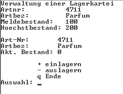
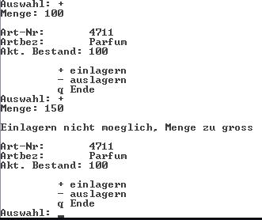
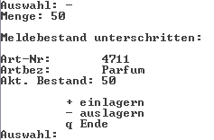
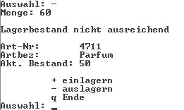

# Учёт складских остатков

Создайте объектно-ориентированную консольную программу для учёта поступлений и выдачи одного товара по складской карточке.

## Ввод данных и меню

При запуске запросите артикул, название товара, порог пополнения (`Meldebestand`) и максимальный остаток (`Höchstbestand`). Начальный остаток равен нулю. Показывайте артикул, название, текущий остаток и меню. Команда `+` означает поступление, `-` — выдачу, `q` — выход. Для поступления или выдачи запросите количество.

## Правила изменения остатка

1. При поступлении прибавьте введённое количество к остатку. Если итог превысит максимум, сообщите об ошибке и оставьте остаток прежним. В примере после поступления 100 единиц попытка принять ещё 150 при максимуме 200 отклоняется.

   

2. Если после выдачи остаток стал меньше порога пополнения, покажите предупреждение о необходимости заказать товар. В примере после выдачи 50 единиц из 100 на складе остаётся 50 при пороге 100.

   

3. Если запрошено больше единиц, чем есть на складе, сообщите об ошибке и оставьте остаток прежним. В примере выдача 60 единиц при остатке 50 отклоняется.

   

Методы класса складской карточки должны сообщать о результате операции вызывающему коду. Сообщения об ошибках выводите в консоль из кода, который обрабатывает меню.
